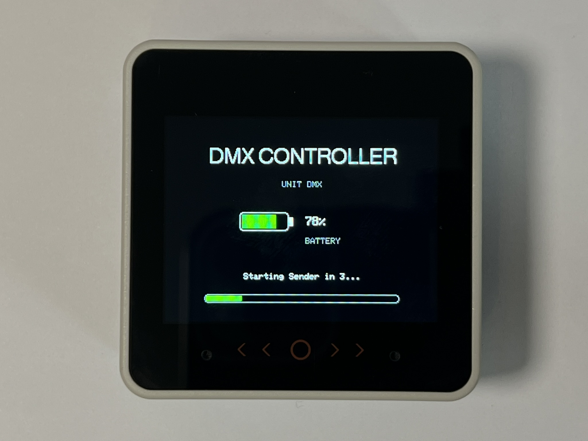
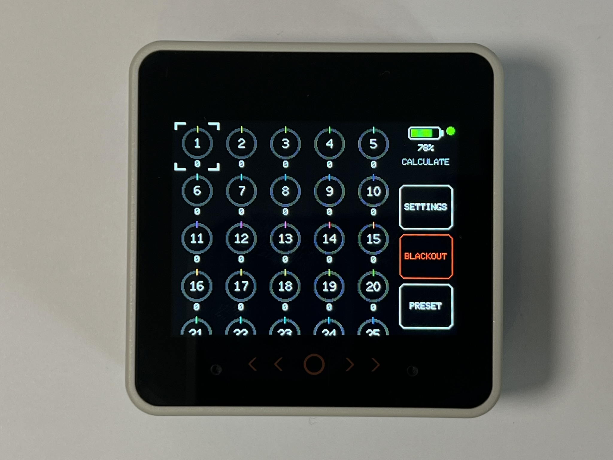
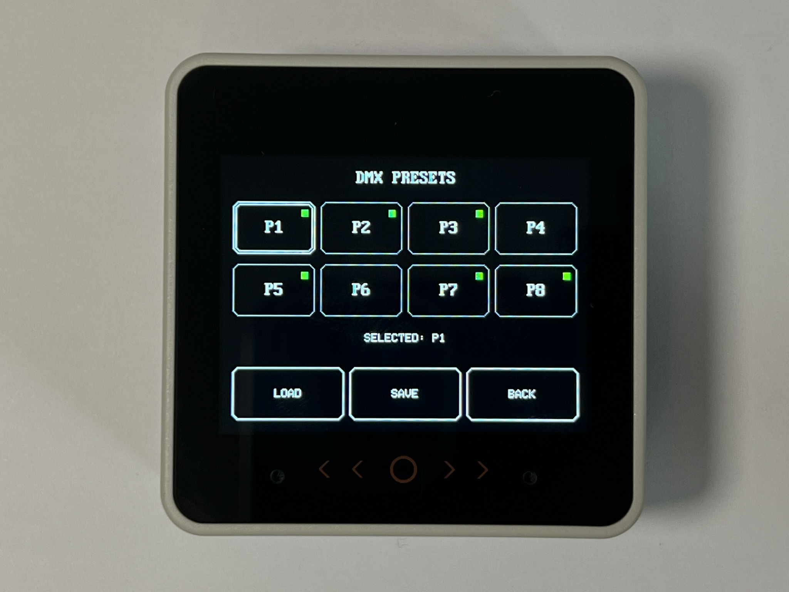
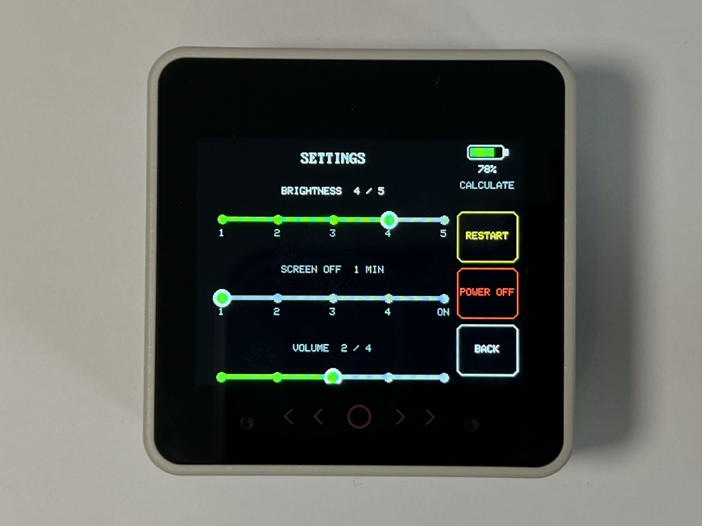

# M5Stack CoreS3SE DMX Controller


A **portable, small-form-factor ESP32-S3 DMX512 controller** built around the **M5Stack CoreS3SE**. It provides a battery-powered touchscreen interface for controlling a full **512-channel DMX universe**, with presets, blackout, battery monitoring and support for **M5Stack Unit DMX** and **DMX Base** hardware. 

> [!IMPORTANT]
> **Recommended / tested setup:** M5Stack CoreS3SE + M5Stack Unit DMX (U183) + M5GO Bottom3.

> [!WARNING]
> **Base DMX support is currently experimental.**
>
> On the Base DMX unit tested during development, random DMX output glitches could be reproduced even with static channel values and simplified test firmware. The same CoreS3SE, fixtures and cabling operated without those glitches when using Unit DMX. This is currently being investigated with M5Stack support and should not be interpreted as a claim that all Base DMX units are affected.

---


<p align="center">
  
</p>

<table width="100%">
  <tr>
    <td align="center" width="50%">
      <br>
      <b>CoreS3SE + Unit DMX</b>
    </td>
    <td align="center" width="50%">
      <br>
      <b>CoreS3SE + Base DMX</b>
    </td>
  </tr>
</table>

### Application Screens

<table>
  <tr>
    <td align="center">
      <br>
      <b>Startup Screen</b>
    </td>
    <td align="center">
      <br>
      <b>Main DMX Screen</b>
    </td>
  </tr>
  <tr>
    <td align="center">
      <br>
      <b>Presets</b>
    </td>
    <td align="center">
      <br>
      <b>Settings Screen</b>
    </td>
  </tr>
</table>

---

## v0.3.0 — Wi-Fi and web control

Control all 512 channels from the touchscreen or the offline web interface at
**http://192.168.4.1/**. Web Editor, Presets, Settings and Status share live
Controller state. JSON Backup, blackout, Device Settings, Maintenance and physically
approved Wi-Fi configuration are included.

Two complete factory images are built from this release source:

- `CoreS3SE-DMX-Unit-v0.3.0.bin` — recommended Unit DMX U183 + Battery Bottom.
- `CoreS3SE-DMX-Base-v0.3.0.bin` — experimental Base DMX + external PSU.

**From v0.2.0:** erase flash, then install the matching factory BIN at 0x0.
Presets/settings are lost. **For the tested current-format v0.3.0:** an application-
only update without erase preserves presets/settings. Never use a factory BIN
for that data-preserving update; it covers the NVS gap.

The user accepted clean erase/install, presets/Backup, reboot persistence and a
no-erase current-v0.3.0 app update on the controller. Base remains experimental.
No separate Wi-Fi/no-Wi-Fi firmware is needed.

- [Installation and update commands](docs/V0_3_0_INSTALLATION.md)
- [Complete changelog](CHANGELOG.md)
- [Release notes](docs/V0_3_0_RELEASE_NOTES_DRAFT.md)
- [Known issues](KNOWN_ISSUES.md)
- [Preset Backup](docs/PRESET_EXPORT_IMPORT.md)

The release manifest records the exact source commit, hardware profile and
checksums. Hosted publication and correction of the old local tag are separate
authorized steps.

## Important operating notes

**Change the predictable factory Wi-Fi password before use in untrusted
environments.** Use web Settings and approve the exact change on the device.
Associated clients share control; HTTP/WebSocket do not have separate encrypted,
per-user administration. This is a local SoftAP, not an internet-facing service.

**Keep this browser tab open and active until the operation completes** when
using Backup Import/Export. Backgrounding intentionally suspends the connection
and cancels transfers; recovery does not replay writes. Import replaces all
P1–P8 slots, including empty slots, without changing live output. Export uses
`DMX-Presets-YY-MM-DD-HH-mm.json` in local browser time. Export before downgrading:
v0.2.0 cannot read current-format generation-backed presets.

Windows/Intel Wi-Fi 6 AX200 **driver 24.20.2.1** has a user-reported SoftAP
compatibility issue (packet loss/WebSocket instability). The verified client
workaround is **Device Manager > Intel Wi-Fi 6 AX200 > Advanced > MIMO Power Save
Mode > No SMPS**. This is not a confirmed firmware defect; see
[known issues](KNOWN_ISSUES.md) for scope and evidence.

The accepted mobile UI uses a fixed-scale viewport and limits pinch zoom.
Historical synchronous TCP send stalls and slow physical touchscreen coordinate
stalls remain disclosed limitations; no permanent timing/accessibility fix is
claimed. Unit acceptance does not certify experimental Base hardware. Read the
[full limitations](KNOWN_ISSUES.md) before installing or using live fixtures.

## Features

- Full **512-channel DMX universe**
- Complete offline mobile/desktop web DMX control, live multi-client synchronization
- Web faders, +/- fine adjustment and direct numeric entry
- Web P1–P8 load/save/delete with overwrite/delete confirmation
- Transactional JSON preset Backup/Import, timestamped downloads and progress dialogs
- Guarded reclamation of obsolete legacy preset blobs after verified generation adoption
- Authoritative web blackout and pre-blackout snapshot restoration
- SoftAP, embedded HTTP/WebSocket assets and automatic connection recovery
- Wi-Fi Configuration with physical approval, expiry and credential recovery
- Live Device Settings previews, commit-on-release and physical/web synchronization
- Web Restart/Power Off confirmation with five-second physical CANCEL
- Touchscreen channel selection and value editing
- Persistent **P1-P8 presets**
- Protected preset save using hold-to-save
- Preset **copy** and **clear**
- **Blackout** with double-tap protection
- DMX activity / heartbeat indicator
- Battery percentage display with charging and external-power indication
- Battery runtime estimation after calibration
- Low-battery visual and audible warnings
- Persistent settings storage
- Screen always-on option
- Touch and startup sounds
- Software RESTART, POWER OFF with Double-tap protection
- Separate hardware profiles for:
  - **M5Stack Unit DMX U183**
  - **M5Stack Base DMX**

---

## Hardware

### Recommended Setup

- [M5Stack CoreS3SE](https://docs.m5stack.com/en/core/M5CoreS3%20SE)
- [M5Stack Unit DMX U183](https://docs.m5stack.com/en/unit/Unit-DMX)
- [M5Stack M5GO Bottom3](https://docs.m5stack.com/en/module/M5GO3%20Bottom)

**Experimental Hardware**
- [M5Stack Base DMX](https://docs.m5stack.com/en/base/DMX_Base)


The M5GO Bottom3 contains a **3.7 V / 500 mAh** battery. In the tested controller configuration, practical runtime was approximately **5 hours**, depending on display brightness, activity and battery condition.

> [!WARNING]
> **Note that, battery is required for Unit DMX and an external PSU for Base DMX to to power DMX hardware!**


---
# Functions

## Physical Presets

Eight presets are available:

```text
P1 P2 P3 P4
P5 P6 P7 P8
```

Preset data is stored persistently in ESP32 NVS.

### Save

Saving is protected against accidental taps.

- Select a preset
- Hold the SAVE control for approximately 1 second
- Progress is shown while holding
- Releasing early cancels the save

### Copy / Clear

Long-press an occupied preset slot to open preset options.

Available operations:

- `COPY`
- `CLEAR`
- `BACK`

Copying is only allowed to an empty destination slot.

Clearing is protected by a hold action.

---

## Physical Blackout

BLACKOUT uses double-tap protection.

```text
First tap  -> TAP AGAIN
Second tap -> BLACKOUT
```

The second tap must arrive within approximately **500 ms**.

When blackout is activated, the current DMX universe is preserved and zero values are transmitted.

Double-tapping again restores the previous values.

---

## Settings

The Settings screen provides:

### Brightness

Five levels:

```text
1 / 2 / 3 / 4 / 5
```

### Screen Timeout

```text
1 / 2 / 3 / 4 / ON
```

`ON` means the display remains on continuously.

### Volume

Five positions:

```text
0 / 1 / 2 / 3 / 4
```

`0` is mute.

### Software Power Controls

The Settings screen also contains:

```text
RESTART
POWER OFF
BACK
```

Both RESTART and POWER OFF require a double tap within approximately **500 ms**.

The established shutdown preparation is retained. Complete zero frames before
shutdown have not been established by external capture.

---

## Offline web interface

In physical Sender Settings, read the current SSID and password. Join the device's
Wi-Fi network and open **http://192.168.4.1/**. The interface works without internet
and in iPhone Safari/Home Screen mode. The AP suppresses its DHCP default-router
option; client cellular routing depends on the OS.

Editor supports all 512 channels. Presets provides Load, Save and Delete; overwrite
and deletion need explicit browser confirmation. Blackout sends zero while keeping
its entry snapshot; edits during blackout do not energize outputs and are discarded
when the original snapshot is restored.

Settings contains Device Settings, Device Maintenance, Wi-Fi Configuration and
browser-only preferences. Slider previews apply live and save on release. Maintenance
requires browser confirmation and allows five seconds to CANCEL on the device.
Wi-Fi changes additionally require physical OK within 60 seconds; CANCEL/expiry
before approval discards them. Rejoin after applying new credentials. Blank New
password keeps the existing password. HOLD RESET WIFI for two seconds schedules a
Wi-Fi-only factory reset for the next explicit restart; presets/settings are kept.

Factory credentials use the AP MAC suffix and are predictable. Change them through
the physical-approval flow. Associated clients share control; WPA2 association is
not a separate administrative authorization layer, and HTTP/WebSocket is not
application-encrypted. No STA/AP+STA or OTA updater is implemented.

**Change the factory Wi-Fi password before use in any untrusted environment.**
Someone who can derive it and join the AP can access DMX, presets and maintenance.
Physical Wi-Fi-change approval does not authenticate ordinary DMX commands.

The accepted mobile UI intentionally restricts browser zoom to avoid the reproduced
iOS gesture regression; this is an accessibility limitation. A slow TCP/WebSocket
send can still block the shared HTTP task temporarily. Automatic recovery is not
a guarantee of uninterrupted delivery. External DMX timing/coherence measurements
remain outstanding; see [release limitations](docs/V0_3_0_RELEASE_NOTES_DRAFT.md).

## Battery Monitoring

The UI displays:

- Battery percentage
- Charging status
- External-power status
- Estimated remaining runtime

Battery indicator colors:

| Battery Level | Color |
|---|---|
| 36-100% | Green |
| 21-35% | Yellow |
| 0-20% | Red |

Runtime estimation begins only after enough discharge data has been collected.

The estimator uses a rolling observation window and smooths the calculated runtime so the displayed value does not jump excessively.

Low-battery warnings are generated at approximately:

- **20%**
- **10%**

Battery-warning tones use a fixed high warning volume independent of the normal UI volume.

---

## DMX Hardware Profiles

The application code is shared. Hardware-specific UART / direction-control settings are selected by the PlatformIO build environment.

### Unit DMX U183

The Unit DMX is connected to **CoreS3SE Port A**.

| Signal | CoreS3SE GPIO |
|---|---:|
| DMX TX | GPIO 2 |
| DMX RX | GPIO 1 |
| Direction / Enable | `-1` |
| Port | Port A |

The Unit DMX handles the RS-485 direction internally, therefore the firmware does not use a separate enable pin.

Example configuration:

```cpp
transmitPin = GPIO_NUM_2;
receivePin  = GPIO_NUM_1;
enablePin   = -1;
```

### Base DMX

The Base DMX uses the CoreS3 M-Bus UART / enable pins used by M5Stack's original DMX512Tools example.

| Signal | CoreS3SE GPIO |
|---|---:|
| DMX TX | GPIO 7 |
| DMX RX | GPIO 10 |
| RS485 Enable | GPIO 6 |

Example configuration:

```cpp
transmitPin = GPIO_NUM_7;
receivePin  = GPIO_NUM_10;
enablePin   = GPIO_NUM_6;
```

---

## PlatformIO Build Environments

Environment names: (unit is default)

```text
cores3se_unit
cores3se_base
```

### Build Unit DMX version

```bash
pio run -e cores3se_unit
```

### Upload Unit DMX version

```bash
pio run -e cores3se_unit -t upload
```

### Build Base DMX version

```bash
pio run -e cores3se_base
```

### Upload Base DMX version

```bash
pio run -e cores3se_base -t upload
```

---

## Software Dependencies

The project is built with PlatformIO and uses:

- PlatformIO `espressif32@6.7.0`, Arduino 2.0.16 / ESP-IDF 4.4.7
- [M5Unified 0.2.21](https://github.com/m5stack/M5Unified)
- [M5GFX 0.2.28](https://github.com/m5stack/M5GFX)
- [esp_dmx](https://github.com/someweisguy/esp_dmx)

The current application branch was developed around **esp_dmx v2.02** because it matches the API used by the original application.

### Reproducible builds and candidate provenance

Repository-local PlatformIO hooks apply and verify the ESP32-S3 compatibility
and reviewed TX ownership/RS485_CLASH patches to upstream esp_dmx v2.02. Do not
manually edit `.pio/libdeps`. Compressed web assets are deterministic and embedded
in firmware; no filesystem upload is required.

Build normally with `pio run -e cores3se_unit` or `pio run -e cores3se_base`.
Read-only `/status` and web Status report version, environment, Git commit,
modified-input flag and source fingerprint. Release binaries must match their
actual committed source and checksums. Pre-commit review builds remain marked
`modified`; after committing, rebuild for clean release identity. Old RCs,
source archives and receipts remain historical and must not be relabeled.

Only production Unit/Base builds are packaged. Diagnostics remain developer
checks. Two OTA slots reserve capacity but do not provide an OTA updater or
validated health rollback. A slow client can still temporarily stall a native
synchronous WebSocket send; bounded queues/recovery do not remove that limitation.
Upper-flash writes, external DMX electrical/frame-coherence measurements and
physical slider precision remain documented limits/deferred work.

---

## Roadmap

Possible future development:

- ESP-NOW wireless DMX transmitter mode
- Small ESP32 / AtomS3 wireless DMX receiver
- Link-quality / RSSI indicator
- Wireless receiver pairing
- Multiple receiver support
- Art-Net / sACN support
- CRMX-compatible hardware exploration
- Fixture profiles
- Named channels
- Additional battery statistics

---

Preset export / import is completed in v0.3.0 (see Backup above); it is no longer
a pending roadmap item.

## Original Source / Acknowledgements

This project is based on and heavily extended from the official M5Stack:

### [DMX512Tools example](https://github.com/m5stack/M5Module-DMX512/tree/master/examples/DMX512Tools)

from the:

### [M5Stack M5Module-DMX512 repository](https://github.com/m5stack/M5Module-DMX512)

The upstream M5Stack repository is distributed under the **MIT License**.

Many thanks to **M5Stack** for publishing the original DMX512Tools example and making it available for further development.

---

## License

This project is released under the **MIT License**.

[LICENSE](LICENSE) preserves the original **Copyright (c) 2022 M5Stack** and
complete upstream MIT text alongside the existing additional-project notice.
[Third-party notices](THIRD_PARTY_NOTICES.md) inventory the exact audited library,
SDK and runtime components. M5GFX contains BSD and other subcomponent terms beyond
its top-level MIT license; Arduino-ESP32 is LGPL-2.1-or-later. The project MIT
license does not replace those terms.

Firmware distribution includes the notice inventory and complete license texts.
Before binary publication, complete the corresponding-source/relink delivery
described in the [build and relink guide](docs/V0_3_0_LGPL_DELIVERY.md), including
the [reviewed build-material inventory](docs/V0_3_0_SOURCE_DISTRIBUTION_INVENTORY.md).
[Publication readiness](docs/V0_3_0_PUBLICATION_READINESS.md) distinguishes the
actual final firmware commit and matching binary/source checksums.

---


## Contributing

Issues, test results and pull requests are welcome.

For Base DMX testing, useful reports should include:

- exact M5Stack host model
- Base DMX revision if known
- power supply
- fixture model
- termination configuration
- firmware build environment
- esp_dmx version
- whether the issue also occurs with static DMX values

Please avoid reporting a Base DMX issue as confirmed hardware failure unless the problem has been isolated with reproducible testing.

---

## Disclaimer

DMX512 controls lighting and related equipment. Test new firmware in a safe environment before using it during a live event.

This project is an independent community project and is **not an official M5Stack product**.

### Deferred physical fader limitation

Slow continuous touchscreen fader movement may exhibit intermittent coordinate stalls originating at or before the touch-controller acquisition layer. Historical upstream code contains the same relevant acquisition mechanisms. No application-level cause was demonstrated. The behavior is not proven to have occurred on the original firmware.

The captured raw-coordinate correction is retained. Touch investigation tools are
explicit opt-ins; THDIFF register-write experiments remain suspended. See
[testing and diagnostic isolation](docs/TESTING.md).
